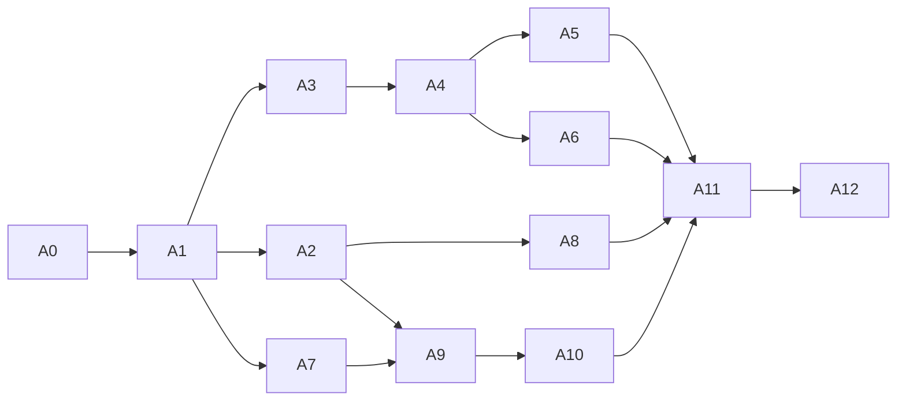

# Fases agénticas de desarrollo

Plan de ejecución de Murk dividido en **13 fases agénticas** (A0–A12), agrupadas en 4 tracks. Cada fase está pensada para que un agente la ejecute de principio a fin en **1–3 sesiones**, con tests, commit y matriz de paridad actualizada; si no cumple el gate, no avanza.

## Estado de ejecución

Actualizado: 2026-11-19.

| Fase | Estado | Evidencia |
|---|---|---|
| **A0** Bootstrap | ✅ completada | commit `943b600`; CI run `44561951766` (frontend y Rust verdes) |
| **A1** Shell | ✅ completada | commit `05f909b`; CI run `44565374891` (18 tests, Rust verde) |
| **A2** Núcleo de archivos | ✅ completada | commits `68167a1`+`742bd3d`; CI run `44574158933` (23 tests frontend, Rust verde) |
| **A3** Editor base | ✅ completada | commit `5de207d`; CI run `44579143309` (26 tests, Rust verde) |
| **A4** Live preview v1 | ✅ completada | commit `60bab23`; CI run `44585953963` (36 tests, Rust verde) |
| **A5** Widgets | ✅ completada | commit `fd55f3a`; CI run `44591278729` (49 tests, Rust verde) |
| **A6** Tablas | ✅ completada | commit `5a8cbd0`; CI run `44594171940` (57 tests, Rust verde) |
| **A7** Workspace UI | ✅ completada | commit `31692dc`; CI run `44597306324` (61 tests, Rust verde) |
| **A8** Recuperación | ✅ completada | commits `430fadc`+`665b545`; CI run `44605471113` (62 tests, Rust verde) |
| **A9** Exportación | ✅ completada | commit `3267bb6`; CI run `44610576993` (62 tests, 33 Rust) |
| **A10–A12** | ⬜ pendientes | — |

**Fases restantes: 3** (A10 a A12).

## Track 0 — Fundación

| Fase | Alcance | Depende de | Gate de salida |
|---|---|---|---|
| **A0** Bootstrap | `.gitignore`, scaffold Tauri+TS, CI, lint, SPDX, ventana “hola” | — | CI verde y app arranca |
| **A1** Shell | Menús, pestañas, ajustes, sesión, abrir/guardar básico | A0 | Flujo abrir→editar→guardar E2E |
| **A2** Núcleo de archivos | Encoding/BOM/EOL, escritura atómica, watcher, conflictos, recientes | A1 | Corpus de archivos sin pérdida de bytes |

## Track 1 — Editor

| Fase | Alcance | Depende de | Gate de salida |
|---|---|---|---|
| **A3** Editor base | CM6 + GFM, resaltado, undo, búsqueda local | A1 | Edición fluida, tests de comandos |
| **A4** Live preview v1 | Decoraciones (headings, énfasis, enlaces, listas, citas, código, HR), reveal-on-cursor, atomic ranges | A3 | Criterios de `docs/05-editor-live-preview.md` |
| **A5** Widgets | Imágenes, math (KaTeX), Mermaid, checkboxes | A4 | Widgets sin alterar el documento |
| **A6** Tablas | Widget, navegación, insertar/eliminar, pegar TSV/CSV | A4 | Criterios de `docs/07-tablas.md` |

## Track 2 — Producto

| Fase | Alcance | Depende de | Gate de salida |
|---|---|---|---|
| **A7** Workspace UI | Sidebar (árbol, outline, búsqueda), barra de estado, temas | A1, A3 | Navegación completa por teclado |
| **A8** Recuperación | Autoguardado, snapshots, crash recovery, historial/diff | A2 | `kill -9` recupera el texto |
| **A9** Exportación | HTML, PDF (Chromium), DOCX/EPUB (Pandoc), CSS print, CLI export | A2, A7 | Documentos de referencia exportados |

## Track 3 — Entrega

| Fase | Alcance | Depende de | Gate de salida |
|---|---|---|---|
| **A10** Integración | CLI, instancia única, `.desktop`/MIME, atajos, spellcheck, IME | A1, A9 | Flujos de sistema y IME estables |
| **A11** Paridad y pulido | Accesibilidad, i18n, rendimiento, casos borde, cierre de matriz | A5, A6, A8, A9, A10 | P0/P1 al 100 % |
| **A12** Release | deb/rpm/AppImage, updater firmado, docs de usuario, QA final | A11 | Instalación limpia + actualización firmada |

## Ejecución

- **Secuencial crítico:** A0 → A1 → A3 → A4 → A5/A6 → A11 → A12.
- **Paralelizable:** A7 con A4–A6; A8 y A9 con A5–A6 (usando worktrees distintos).
- **Estimación:** ~25–32 sesiones agénticas en total (A4, A6 y A9 son las más caras).
- **Regla por fase:** una rama/PR, tests nuevos, `cargo clippy -D warnings`, matriz actualizada y commit conventional. Sin secretos ni assets de Typora.

## Puertas que requieren humano

- Validación de UX/visual (A4, A7).
- Decisión sobre motor PDF si Chromium falla (A9).
- Firma y publicación del release (A12).
- Cualquier cambio de alcance que rompa la matriz P0/P1.

## Contrato de una fase agéntica

Cada fase debe declarar y cumplir:

1. **Objetivo:** una sola capacidad verificable.
2. **Documentos de referencia:** rutas de `docs/` y `specs/` aplicables.
3. **Archivos permitidos:** límites para evitar colisiones entre agentes.
4. **Comandos de verificación:** build, tests, lint y E2E mínimos.
5. **Entregable:** código + pruebas + actualización de `specs/matriz-paridad-typora.md`.
6. **Criterio de parada:** gate cumplido o bloqueo documentado; nunca “casi listo”.
