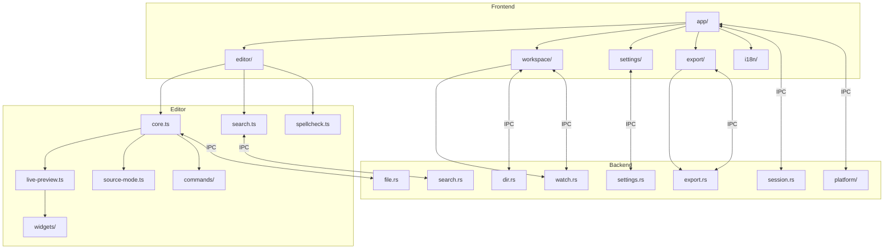

# Diagrama — Módulos



## Acoplamiento

- `editor/` no conoce Tauri: recibe una interfaz `HostApi` inyectada.
- `workspace/` y `settings/` dependen de comandos tipados.
- `export/` reutiliza el render del editor solo a través de una API pública.
- Los widgets no acceden a red ni a disco directamente.

## Regla de dependencias

```text
ui -> app -> editor -> widgets
ui -> workspace -> host
export -> render -> editor
nunca: editor -> tauri
nunca: widgets -> fs
```
