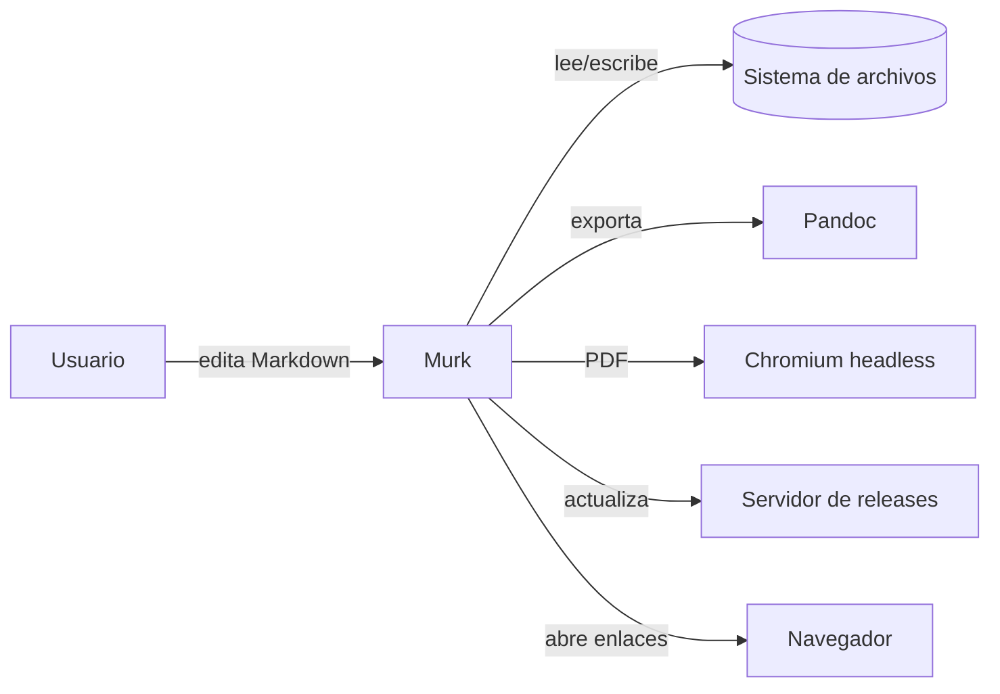
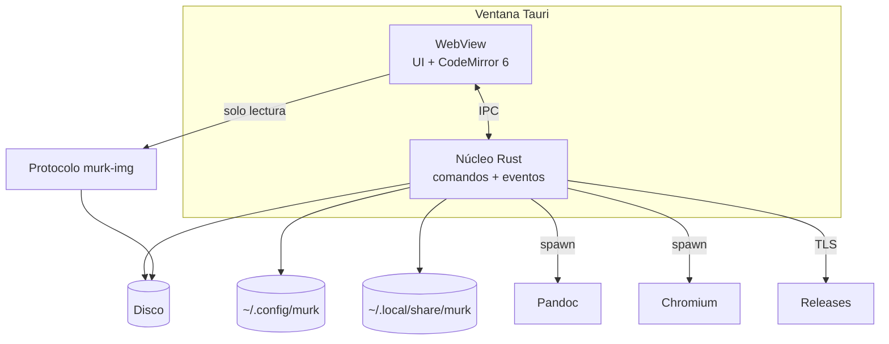

# Diagrama — Contexto y contenedores (C4)

## Nivel 1: contexto

## Nivel 2: contenedores

## Responsabilidades

| Contenedor | Hace | No hace |
|---|---|---|
| WebView | Editor, render, UI, estado efímero | IO directo no autorizado |
| Rust core | IO, watcher, búsqueda, exportación, persistencia | Render |
| Pandoc | Conversión DOCX/EPUB/ODT/LaTeX | Interpretar el editor |
| Chromium | Impresión a PDF | Acceso a datos del usuario |
| Servidor | Manifiesto firmado y artefactos | Recibir documentos |

## Fronteras de confianza

- El contenido del documento es **no confiable** (HTML/SVG se sanea).
- Los sidecars reciben solo rutas y argumentos validados.
- El servidor de actualizaciones nunca recibe datos del usuario.
