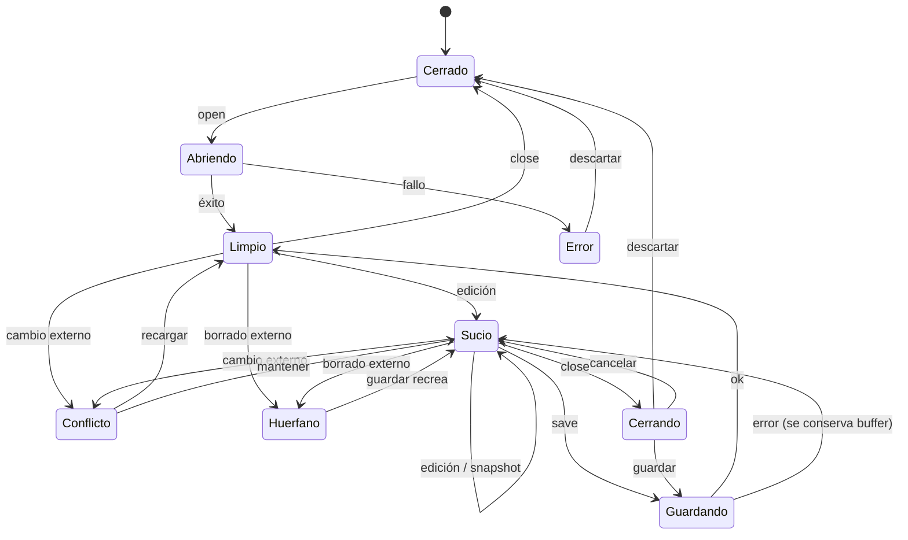

# Diagrama — Estados del documento

## Invariantes

| Estado | Invariante |
|---|---|
| Limpio | `content` == disco |
| Sucio | `content` ≠ disco |
| Guardando | No se aceptan nuevas escrituras simultáneas |
| Conflicto | No se autoguarda |
| Huérfano | No se autoguarda hasta decisión |
| Cerrado | Sin watcher ni snapshots |

## Transiciones prohibidas

- Limpio → Cerrado sin comprobar disco.
- Conflicto → Guardando automático.
- Sucio → Cerrado sin diálogo.
- Cualquier estado → Abriendo si ya está abierto.
