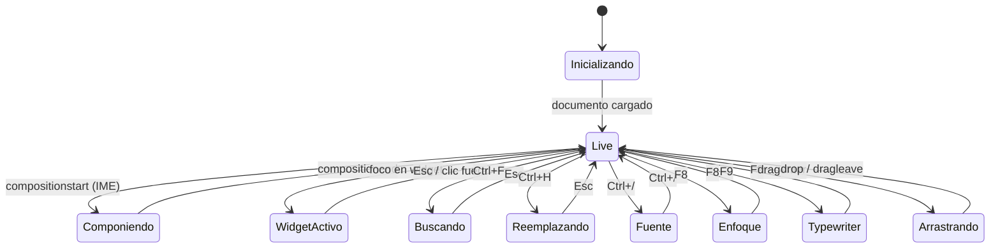

# Diagrama — Estados del editor

## Reglas por estado

| Estado | Regla |
|---|---|
| Componiendo | Sin transacciones ni decoraciones en el rango |
| WidgetActivo | Las teclas del widget no editan el texto |
| Buscando | El foco está en el panel; `Esc` vuelve al editor |
| Fuente | Sin widgets (excepto imágenes P2) |
| Enfoque | Solo el bloque activo con opacidad completa |
| Typewriter | Línea activa centrada |
| Arrastrando | Se muestra indicador de destino |

## Prioridad

`Componiendo` > `WidgetActivo` > `Buscando` > modos de vista.

Nunca se puede entrar en `Componiendo` y `Buscando` a la vez.
