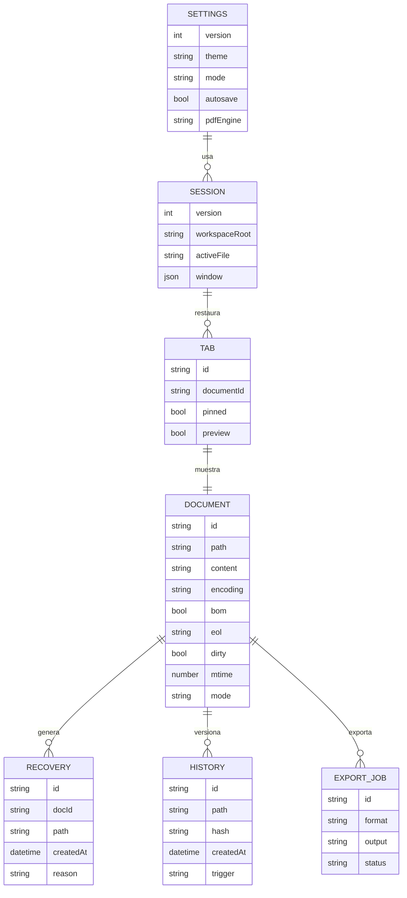

# Diagrama — Modelo de datos



## Archivos en disco

```text
~/.config/murk/
├── settings.json
├── session.json
├── themes/<tema>/
└── recovery/<docId>/<ts>.json

~/.local/share/murk/
├── history/index.json
├── history/<hash>.zst
├── backups/<hash>/<ts>.md
└── dictionaries/
```

## Ciclo de vida

1. Abrir → `Document` en memoria (`dirty=false`).
2. Editar → `dirty=true`, snapshots periódicos.
3. Guardar → escritura atómica, `history` si cambió, limpiar recovery.
4. Cerrar → quitar watcher, persistir sesión.
5. Crash → recovery queda hasta el siguiente arranque.
