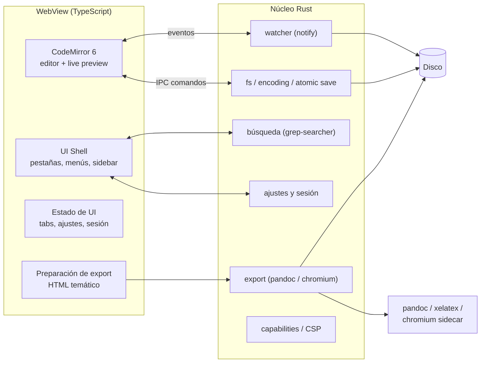
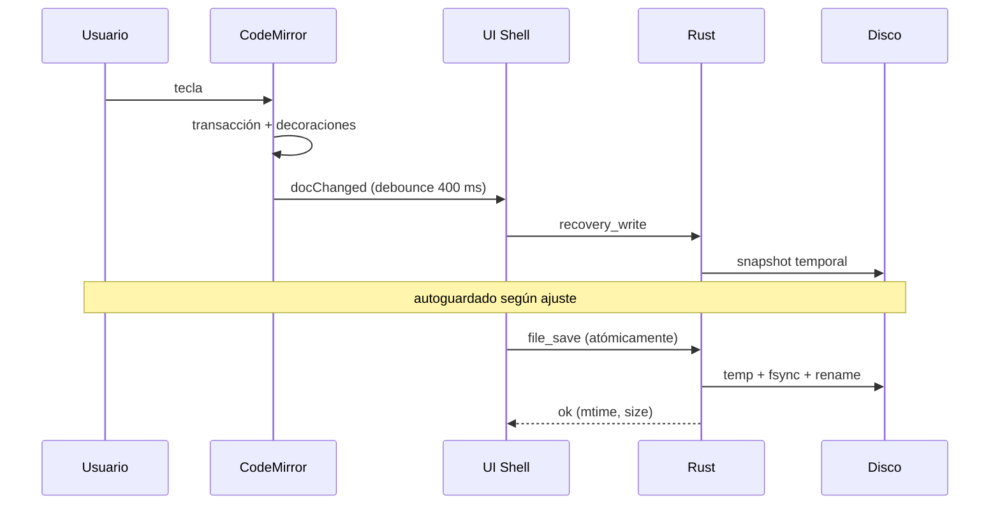

# 02 — Arquitectura

## 1. Vista general

Murk es una aplicación Tauri v2: una WebView ejecuta la interfaz y el editor (TypeScript + CodeMirror 6), mientras un núcleo Rust realiza operaciones de sistema (archivos, watcher, búsqueda, exportación, ajustes). La comunicación es por comandos IPC tipados y eventos.



## 2. Procesos y responsabilidades

| Proceso | Responsabilidad | Nunca hace |
|---|---|---|
| WebView (UI) | Render, editor, input, CSS, estado efímero | Acceso directo al disco fuera de la API |
| Rust core | IO, watcher, búsqueda, exportación, persistencia | Render de UI |
| Sidecars | Pandoc, Chromium, LaTeX | Reciben solo rutas temporales y argumentos validados |

## 3. Módulos del frontend

```text
src/
├── main.ts                 # arranque, router de vistas
├── app/
│   ├── lifecycle.ts        # abrir/cerrar ventana, sesión
│   ├── menu.ts             # menú nativo y contextual
│   ├── commands.ts         # registro y keybindings
│   └── errors.ts           # notificaciones y recuperación
├── editor/
│   ├── core.ts             # EditorView, estado, transacciones
│   ├── live-preview.ts     # decoraciones y reveal-on-cursor
│   ├── source-mode.ts      # alternancia y scroll sync
│   ├── widgets/            # image, math, mermaid, table, checkbox
│   ├── commands/           # formato, listas, tablas, enlaces
│   ├── search.ts           # panel de búsqueda
│   └── spellcheck.ts       # subrayado y sugerencias
├── workspace/
│   ├── tabs.ts
│   ├── tree.ts
│   ├── outline.ts
│   └── watcher.ts
├── export/
│   ├── html.ts
│   ├── pdf.ts
│   └── pandoc.ts
├── settings/
└── i18n/
```

## 4. Módulos Rust

```text
src-tauri/src/
├── main.rs
├── commands/
│   ├── file.rs        # read/write/atomic/encoding/EOL
│   ├── dir.rs         # árbol, rename, trash
│   ├── watch.rs       # notify + debounce + eventos
│   ├── search.rs      # grep-searcher
│   ├── export.rs      # pandoc, chromium, weasyprint
│   ├── session.rs     # sesión, recientes, snapshots
│   └── settings.rs    # JSON validado
├── security/          # scopes, validación de rutas
├── platform/          # .desktop, MIME, single-instance
└── error.rs           # errores tipados -> UI
```

## 5. Contrato IPC

### Comandos (UI → Rust)

| Comando | Entrada | Salida |
|---|---|---|
| `file_open` | `path` | `DocumentPayload` |
| `file_save` | `path, content, encoding, eol` | `SaveResult` |
| `file_save_as` | `suggestedName` | `path \| null` |
| `dir_list` | `path` | `TreeNode[]` |
| `dir_watch` | `path` | `watchId` |
| `search_workspace` | `query, options` | `SearchHit[]` |
| `export_run` | `ExportRequest` | `ExportResult` |
| `session_load` / `session_save` | — / `Session` | `Session` |
| `settings_load` / `settings_save` | — / `Settings` | `Settings` |
| `recovery_write` | `docId, content` | `snapshotId` |
| `recovery_list` / `recovery_restore` | — / `snapshotId` | `Snapshot[]` / `DocumentPayload` |
| `platform_open_external` | `url` | `void` |

### Eventos (Rust → UI)

| Evento | Carga | Uso |
|---|---|---|
| `file:changed` | `path, mtime, size` | Conflicto de edición externa |
| `file:deleted` | `path` | Cerrar pestaña o marcar huérfana |
| `tree:changed` | `path` | Refrescar árbol |
| `export:progress` | `jobId, phase, pct` | Barra de progreso |
| `update:available` | `version, notes` | Aviso de actualización |
| `app:open-file` | `path` | Segunda instancia / CLI |

Reglas:

- Todo payload se valida con Serde y esquemas TypeScript generados.
- Los errores usan un enum `AppError { code, message, detail? }` mostrado como notificación no bloqueante salvo pérdida de datos.
- No se exponen rutas arbitrarias: el core valida contra los scopes concedidos.

## 6. Flujo de datos de una edición



## 7. Seguridad

- `capabilities/` con permisos mínimos: solo directorios abiertos por el usuario.
- CSP estricta; sin `unsafe-eval`; sin contenido remoto por defecto.
- Protocolo de imágenes propio con scope de directorio del documento.
- Sidecars con lista blanca de argumentos y timeout.
- Ver detalles en `18-seguridad-privacidad.md`.

## 8. Persistencia y rutas

| Dato | Ruta (XDG) |
|---|---|
| Ajustes | `~/.config/murk/settings.json` |
| Sesión/recientes | `~/.config/murk/session.json` |
| Recuperación | `~/.config/murk/recovery/` |
| Historial local | `~/.local/share/murk/history/` |
| Caché (mermaid, miniaturas) | `~/.cache/murk/` |
| Temas de usuario | `~/.config/murk/themes/` |
| Diccionarios | `~/.local/share/murk/dictionaries/` |

## 9. Errores y observabilidad

- Log rotativo en `~/.cache/murk/logs/murk.log` (nivel configurable).
- Sin telemetría por defecto.
- Crash reporter local: guarda estado y ofrece recuperación al reiniciar.
- IDs de correlación por operación para depurar sin datos del documento.
