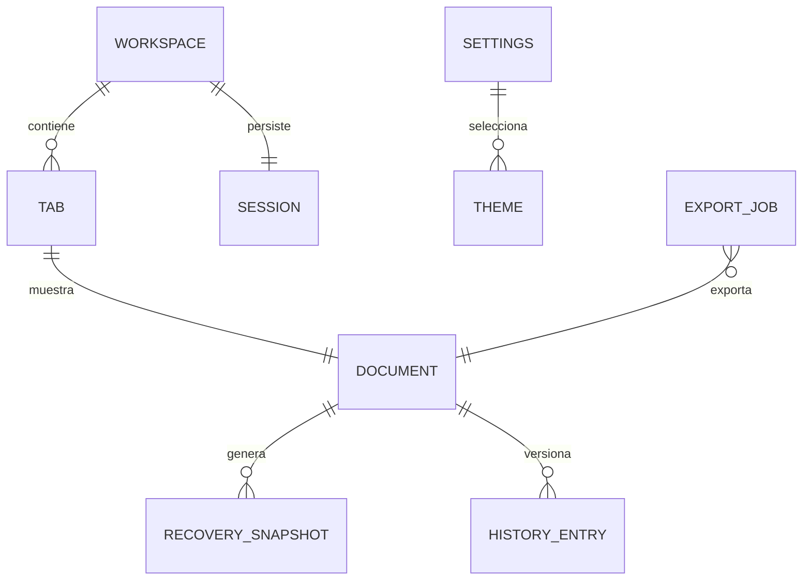

# 03 — Modelo de datos

## 1. Entidades



### Document

| Campo | Tipo | Descripción |
|---|---|---|
| `id` | UUID | Identidad estable de la pestaña |
| `path` | string \| null | Ruta absoluta; `null` si no se ha guardado |
| `displayName` | string | Nombre visible |
| `content` | string | Texto en memoria (fuente de verdad) |
| `encoding` | string | `utf-8`, `utf-16le`, `gb18030`… |
| `bom` | boolean | Presencia de BOM |
| `eol` | `"lf" \| "crlf" \| "cr"` | Fin de línea detectado |
| `dirty` | boolean | Cambios sin guardar |
| `readOnly` | boolean | Archivo sin permisos de escritura |
| `mtime` | number | mtime en disco al abrir/guardar |
| `size` | number | Bytes |
| `language` | string | Idioma del corrector (`es`, `en-US`) |
| `scroll` | number | Posición de scroll (0–1) |
| `cursor` | `{anchor, head}` | Selección |
| `mode` | `"live" \| "source"` | Modo de vista |

### Tab

```ts
interface Tab {
  id: string;
  documentId: string;
  pinned: boolean;
  preview: boolean;   // pestaña de vista previa (un clic)
  lastActiveAt: number;
}
```

### Workspace

```ts
interface Workspace {
  rootPath: string | null;
  tabs: Tab[];
  activeTabId: string | null;
  sidebar: { view: "files" | "outline" | "search" | null; width: number };
  panels: { statusBar: boolean; wordCount: boolean };
}
```

### Session (persistida)

```json
{
  "version": 1,
  "workspaceRoot": "/home/roy/notas",
  "openFiles": [
    { "path": "/home/roy/notas/a.md", "cursor": 42, "scroll": 0.31, "mode": "live" }
  ],
  "activeFile": "/home/roy/notas/a.md",
  "window": { "width": 1280, "height": 800, "maximized": false },
  "recent": ["/home/roy/notas/a.md"]
}
```

### RecoverySnapshot

| Campo | Tipo | Descripción |
|---|---|---|
| `id` | string | `docId-timestamp` |
| `docId` | string | Documento |
| `path` | string \| null | Ruta original |
| `content` | string | Contenido completo |
| `createdAt` | number | epoch ms |
| `reason` | `"interval" \| "blur" \| "close" \| "crash"` | Origen |

Ubicación: `~/.config/murk/recovery/<docId>/<timestamp>.json` (o `.md` + sidecar para inspección manual). Retención: 7 días o 50 por documento.

### HistoryEntry

| Campo | Tipo |
|---|---|
| `id` | string |
| `path` | string |
| `hash` | string (sha256 del contenido) |
| `content` | string comprimido (zstd) |
| `createdAt` | number |
| `trigger` | `"save" \| "manual" \| "export"` |

Índice en `~/.local/share/murk/history/index.json`; contenidos en archivos comprimidos.

### Settings (extracto)

```ts
interface Settings {
  version: number;
  appearance: {
    theme: string;            // id
    mode: "light" | "dark" | "system";
    fontFamily: string | null;
    monoFontFamily: string | null;
    fontSize: number;
    lineHeight: number;
    maxWidth: number;         // ch
    zoom: number;
  };
  editor: {
    defaultMode: "live" | "source";
    autosave: "off" | "interval" | "blur" | "save";
    autosaveIntervalMs: number;
    spellcheck: boolean;
    spellcheckLanguage: string;
    smartPunctuation: boolean;
    hardBreaks: boolean;
    showLineNumbers: boolean;
    codeLineNumbers: boolean;
    typewriterMode: boolean;
    focusMode: boolean;
    matchBrackets: boolean;
    autoPair: boolean;
  };
  files: {
    autoSaveOnClose: boolean;
    restoreSession: boolean;
    imageInsert: "copy" | "relative" | "absolute";
    imageFolder: string;
    defaultEncoding: string;
    trimTrailingWhitespace: boolean;
  };
  export: {
    pdfEngine: "chromium" | "pandoc";
    pdfPageSize: "A4" | "Letter" | "Legal";
    pdfMarginMm: number;
    embedImages: boolean;
    pandocPath: string | null;
    keepHtml: boolean;
  };
  keybindings: Record<string, string>;
  advanced: { logLevel: "error" | "warn" | "info" | "debug" };
}
```

## 2. Invariantes

1. `content` es siempre el texto exacto que se guardará (salvo normalización EOL explícita).
2. `dirty` solo cambia por transacciones del editor o guardados.
3. Guardar no reordena ni reformatea el documento.
4. `mtime` se actualiza tras guardar; si el disco cambia, se detecta conflicto.
5. Un documento sin `path` no se autoguarda en disco: solo en recovery.
6. La sesión nunca guarda contenido completo, solo rutas y posiciones.

## 3. Persistencia

- Escritura atómica: `archivo.tmp` en el mismo directorio → `fsync` → `rename`.
- Ajustes y sesión con escritura atómica y validación de esquema; si el JSON está corrupto, se renombra a `.bak` y se usan valores por defecto.
- Migraciones versionadas (`version` en cada archivo).
- Sin base de datos en v1; JSON + archivos comprimidos para historial.

## 4. Límites

| Límite | Valor inicial |
|---|---|
| Tamaño de documento editable | 20 MB (aviso > 5 MB) |
| Snapshots por documento | 50 |
| Historial por archivo | 100 versiones / 200 MB |
| Búsqueda global | 10 000 resultados, 200 MB escaneados |
| Pestañas | 50 (aviso) |
| Watchers | 4 096 directorios |
