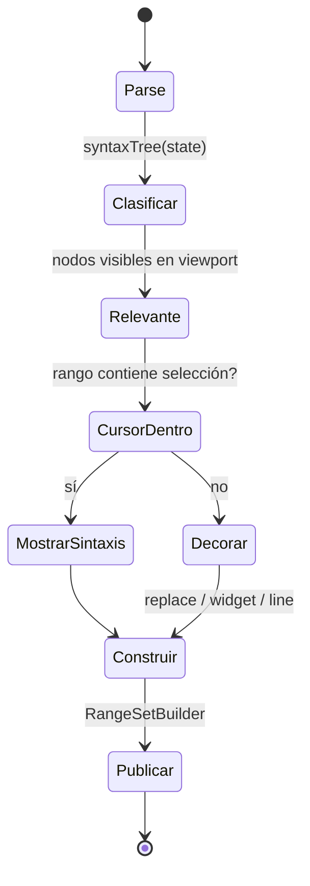

# 05 — Editor y preview en vivo

## 1. Principio

Una sola superficie: el usuario escribe Markdown y ve el resultado formateado en el mismo lugar, sin panel dividido. La sintaxis se oculta cuando no es necesaria y reaparece al colocar el cursor en el nodo.

## 2. Stack del editor

| Pieza | Paquete | Función |
|---|---|---|
| Estado/vista | `@codemirror/state`, `@codemirror/view` | Documento, transacciones, render |
| Markdown | `@codemirror/lang-markdown`, `@lezer/markdown` | Parser incremental + GFM |
| Comandos | `@codemirror/commands` | Historial, selección, indentación |
| Búsqueda | `@codemirror/search` | Panel local |
| Autocompletado | `@codemirror/autocomplete` | Enlaces, fences, emoji |
| Resaltado | `@codemirror/language` + Shiki | Bloques de código |
| KaTeX / Mermaid | widgets propios | Bloques y fórmulas |

Extensiones base: `history`, `drawSelection`, `dropCursor`, `rectangularSelection`, `crosshairCursor`, `highlightActiveLine` (solo en modo fuente), `bracketMatching`, `closeBrackets`, `highlightSelectionMatches`, `EditorView.lineWrapping`.

## 3. Algoritmo de preview



Reglas:

1. Un `ViewPlugin` reconstruye decoraciones cuando cambian documento, selección, viewport o configuración (con debounce de 1 frame).
2. **Nunca** se decora un nodo cuyo rango contenga el cursor o la selección, salvo elementos de bloque cuyo contenido sea editable.
3. Los rangos ocultos se declaran en `EditorView.atomicRanges` para que ←/→ los salten.
4. Los widgets se montan solo para el viewport; al salir se destruyen.
5. Las decoraciones son puramente visuales: no modifican el documento.

## 4. Transformaciones por tipo de nodo

| Nodo | Decoración | Al entrar el cursor |
|---|---|---|
| `ATXHeading1..6` | `line` con clase + ocultar `HeaderMark` y espacio | Se muestra `#` |
| `SetextHeading` | `line` + ocultar subrayado | Se muestra |
| `Emphasis` / `StrongEmphasis` | ocultar `EmphasisMark` (`*`, `_`) | Se muestran marcas |
| `InlineCode` | ocultar backticks + fondo | Se muestran |
| `Strikethrough` | ocultar `~~` + tachado | Se muestran |
| `Highlight` (`==`) | ocultar `==` + fondo | Se muestran |
| `Link` | ocultar `[]()` y mostrar texto subrayado; tooltip con URL | Se muestra sintaxis |
| `Image` | widget con imagen y alt | Se muestra sintaxis |
| `Blockquote` | `line` con barra y sangría | Sin cambios |
| `BulletList` / `OrderedList` | ocultar `ListMark`; viñeta/número widget | Se muestra marca |
| `Task` | checkbox interactivo | Se muestra `[ ]` |
| `FencedCode` | ocultar fences; Shiki dentro; botón copiar/lenguaje | Se muestran fences |
| `HorizontalRule` | línea decorativa | Se muestra `---` |
| `Table` | widget/tabla (ver 07) | Se muestra fuente |
| `BlockMath` | widget KaTeX | Se muestra `$$` |
| `InlineMath` | widget KaTeX | Se muestra `$` |
| `Mermaid` (fence ```mermaid) | widget renderizado | Se muestra fuente |
| `HtmlBlock` | render saneado (ver 06) | Se muestra HTML |
| `Frontmatter` | bloque plegado “Metadatos” | Se despliega |

## 5. Widgets

Contrato común:

```ts
interface MurkWidget extends WidgetType {
  eq(other: WidgetType): boolean;   // evita re-render
  toDOM(view: EditorView): HTMLElement;
  destroy?(dom: HTMLElement): void;
  estimatedHeight?: number;
  ignoreEvent?(event: Event): boolean;
}
```

- **Imagen**: carga por protocolo interno; placeholder con alt si falla; respeta `width`/`height` de HTML.
- **Math**: render KaTeX sincrónico (inline) o diferido (bloque > 200 ms); error visible con el código fuente.
- **Mermaid**: render diferido en `requestIdleCallback`, cache por hash de fuente+tema; errores muestran el mensaje de Mermaid y el código.
- **Tabla**: ver documento 07.
- **Checkbox**: delegación de clic → transacción que cambia `[ ]`/`[x]`; undoable.

## 6. Modos

| Modo | Comportamiento |
|---|---|
| **Live** (por defecto) | Preview descrito arriba |
| **Source** | Markdown crudo, resaltado, números de línea opcionales, sin widgets (salvo imágenes P2) |
| Alternancia | `Ctrl+/`; conserva cursor y scroll (mapeo por offset) |

## 7. Modos de escritura

- **Enfoque**: atenúa todos los bloques salvo el del cursor.
- **Máquina de escribir**: mantiene la línea activa centrada verticalmente.
- Ambos combinables; estado por sesión.

## 8. Edición

| Acción | Regla |
|---|---|
| Enter en lista | Continúa marca; en lista vacía, la termina |
| Tab en lista | Anida; `Shift+Tab` desanida |
| Enter en cita | Nueva línea con `>`; vacía termina |
| Backspace al inicio de bloque | Convierte a párrafo |
| Pegar URL sobre selección | Crea enlace |
| Pegar imagen | Inserta imagen (ver 09) |
| Autopar | `*`, `_`, `` ` ``, `(`, `[`, `"` configurables |
| Puntuación inteligente | Comillas y guiones tipográficos si está activo |
| Deshacer | Por transacción; agrupación por ráfaga de tecleo (500 ms) |

## 9. IME y composición

- Mientras `view.composing === true`, no se aplican decoraciones que alteren el rango en composición.
- Se prohíbe cualquier `dispatch` durante `compositionstart`–`compositionend`.
- Pruebas obligatorias con ibus y fcitx5 (español, japonés, chino).

## 10. Rendimiento

- Parse incremental de Lezer; decoraciones solo del viewport.
- `WidgetType.eq` para no re-renderizar.
- Mermaid/KaTeX diferidos y cacheados.
- Documentos > 5 MB: widgets desactivados por defecto; > 20 MB: modo fuente forzado con aviso.

## 11. Criterios de aceptación

1. Al mover el cursor a `**texto**`, se ven los asteriscos; al salir, se ocultan.
2. Las flechas atraviesan un widget de imagen sin entrar en su DOM.
3. Escribir 10 000 caracteres no produce saltos de scroll ni pérdida de foco.
4. Deshacer tras cambiar un checkbox restaura el estado.
5. Cambiar de modo conserva la posición lógica del cursor.
6. El documento en disco no cambia al renderizar widgets.
