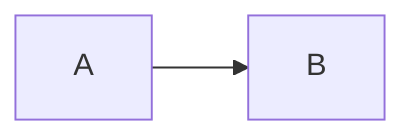

# 08 — Matemáticas y diagramas

## 1. Matemáticas

### Sintaxis

| Forma | Markdown | Render |
|---|---|---|
| En línea | `$E=mc^2$` | KaTeX inline |
| Bloque | `$$\n\\int_0^1 x^2 dx\n$$` | KaTeX display centrado |
| Bloque alternativo | `\[ … \]` | P1 |
| Numeración | `\tag{1}` | P1 |

- Delimitadores `$` solo si no hay espacio inmediato interior (evita falsos positivos con precios).
- `\$` escapa el signo.
- El contenido se pasa a KaTeX con `throwOnError: false` y `strict: false`.
- Error: se muestra el bloque en rojo con el mensaje y el código editable.
- Copiar fórmula: menú contextual → “Copiar LaTeX” / “Copiar como PNG” (P2).

### Configuración

- Macros globales definidas por el usuario en `settings.json` (`math.macros`).
- Tema de KaTeX según claro/oscuro.
- Tamaño de fuente heredado del documento.

### Exportación

- HTML/PDF: KaTeX ya renderizado o MathML como fallback.
- DOCX/EPUB: `pandoc --mathml` (o `--webtex` si se elige imagen remota, desactivado por defecto).
- Nunca se envía la fórmula a un servidor.

## 2. Diagramas Mermaid

### Detección

Un fence con info string `mermaid` (primer token, case-insensitive) se renderiza como diagrama:

````markdown

````

### Tipos soportados (P0)

| Tipo | Uso |
|---|---|
| `flowchart` / `graph` | Diagramas de flujo |
| `sequenceDiagram` | Secuencias |
| `classDiagram` | Clases |
| `stateDiagram-v2` | Estados |
| `erDiagram` | Entidad-relación |
| `gantt` | Planificación |
| `pie` | Tarta |
| `journey` | Experiencia de usuario |
| `gitGraph` | Ramas Git |
| `mindmap` | Mapas mentales |
| `timeline` | Cronologías |
| `quadrantChart` | Cuadrantes |

P2: `flowchart.js` y `js-sequence-diagrams` (compatibilidad con fences `flow` y `sequence`).

### Render

1. Se calcula hash `sha256(fuente + tema + versión)`.
2. Si hay caché en memoria o disco, se usa.
3. Si no, se renderiza con Mermaid en un Web Worker o `requestIdleCallback`.
4. El SVG se inserta como widget; se adapta al ancho (max-width 100 %).
5. Errores: se muestra el mensaje de Mermaid y el código; nunca se rompe el documento.

### Interacción

- Clic: selecciona el bloque.
- Botón flotante: “Ver grande”, “Copiar SVG”, “Abrir fuente”, “Exportar PNG” (P1).
- Zoom en el visor con `+`/`-`/`0`.
- El SVG respeta `prefers-color-scheme` y el tema.

### Seguridad

- Mermaid se ejecuta con `securityLevel: 'strict'`.
- Se prohíben `click` handlers con JavaScript y enlaces `javascript:`.
- El SVG se sanea antes de insertarse.

### Exportación

- HTML/PDF: SVG inline (mejor fidelidad) o PNG a 2× si se elige rasterizar.
- DOCX/EPUB: PNG a 2× (Pandoc no incrusta SVG en DOCX de forma fiable).
- Se conserva el bloque `mermaid` original en el `.md`.

## 3. Diagramas de otros lenguajes

| Fence | Tratamiento |
|---|---|
| `mermaid` | Diagrama Mermaid |
| `flow` | flowchart.js (P2) |
| `sequence` | js-sequence-diagrams (P2) |
| `plantuml` | No soportado (P3, requiere servidor/binario) |
| `vega`/`vega-lite` | P3 |

## 4. Criterios de aceptación

1. `$x^2$` se renderiza sin alterar el texto del documento.
2. Un `$` suelto (por ejemplo “cuesta $5”) no abre una fórmula.
3. Un fence mermaid inválido muestra error y sigue siendo editable.
4. Cambiar de tema re-renderiza los diagramas con los colores nuevos.
5. El SVG exportado coincide visualmente con el del editor.
6. Los diagramas no bloquean el tecleo (render diferido verificable).
7. El documento guardado mantiene exactamente el código del diagrama.
