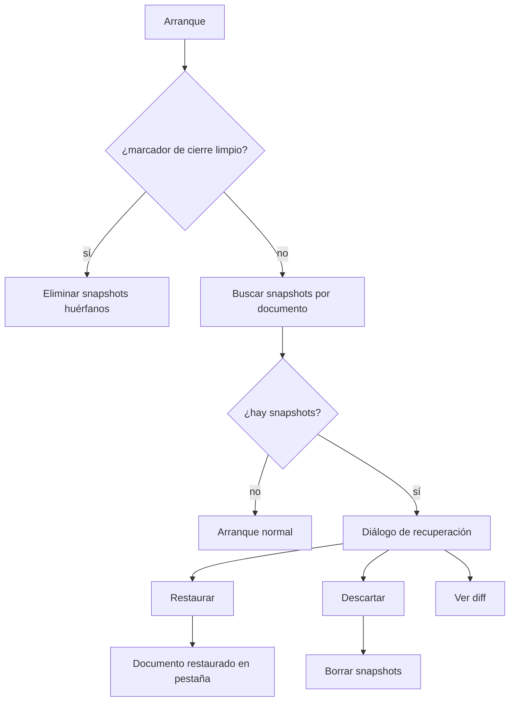

# 11 — Autoguardado, recuperación e historial

## 1. Autoguardado

| Modo | Cuándo guarda en disco |
|---|---|
| `off` | Solo `Ctrl+S` |
| `blur` | Al perder el foco la ventana |
| `interval` | Cada N segundos (30 por defecto) si hay cambios |
| `save` | Al cambiar de pestaña y al cerrar |

Reglas:

- Nunca guarda un documento sin ruta: escribe snapshot de recuperación.
- No guarda mientras hay una composición IME activa.
- Si el archivo cambió externamente, no sobrescribe: abre conflicto.
- Indicador en barra de estado: “Guardado hace 12 s” / “Sin guardar”.

## 2. Snapshots de recuperación

- Cada 5 s de inactividad tras un cambio, o cada 30 s durante escritura continua.
- Se escriben en `~/.config/murk/recovery/<docId>/`.
- Formato: `{id, path, content, createdAt, reason}` en JSON; contenido también como `.md` legible para rescate manual.
- Se eliminan al guardar correctamente y al cerrar limpio.
- Retención: 7 días o 50 por documento.

## 3. Recuperación tras cierre anómalo

Detalles:

- El diálogo muestra archivo, hora y tamaño; selección múltiple.
- “Ver diff” compara snapshot vs disco.
- Restaurar abre el contenido en memoria sin guardar; el usuario decide.
- Nunca se sobrescribe automáticamente el archivo original.

## 4. Historial local (control de versiones)

- Se crea una entrada al guardar, si el contenido cambió.
- Compresión zstd; índice con hash, fecha y tamaño.
- Límites: 100 versiones o 200 MB por archivo; se eliminan las más antiguas.
- Acciones: ver versiones, diff lado a lado, restaurar (abre copia), exportar versión.
- Desactivable por usuario; nunca sube a red.
- Ubicación: `~/.local/share/murk/history/`.

## 5. Backup al guardar

Opcional (`files.backupOnSave`):

- Copia previa a `~/.local/share/murk/backups/<hash>/<timestamp>.md` antes de escribir.
- Retención 30 días.
- No sustituye al historial: es una red de seguridad ante corrupción.

## 6. Conflictos

| Situación | Acción |
|---|---|
| Cambio externo sin cambios locales | Recarga silenciosa |
| Cambio externo con cambios locales | Diálogo: recargar / mantener / comparar |
| Guardado falla por permisos | Se mantiene el buffer y se ofrece Guardar como |
| Snapshot corrupto | Se ignora y se registra en log |

## 7. Criterios de aceptación

1. `kill -9` durante la edición conserva el texto en el diálogo de recuperación.
2. Restaurar un snapshot no modifica el archivo hasta que el usuario guarde.
3. El historial permite volver a una versión anterior sin perder la actual.
4. Guardar un documento sin cambios no crea versión nueva.
5. El autoguardado no interfiere con IME ni con deshacer.
6. Los snapshots se limpian tras un cierre normal.
