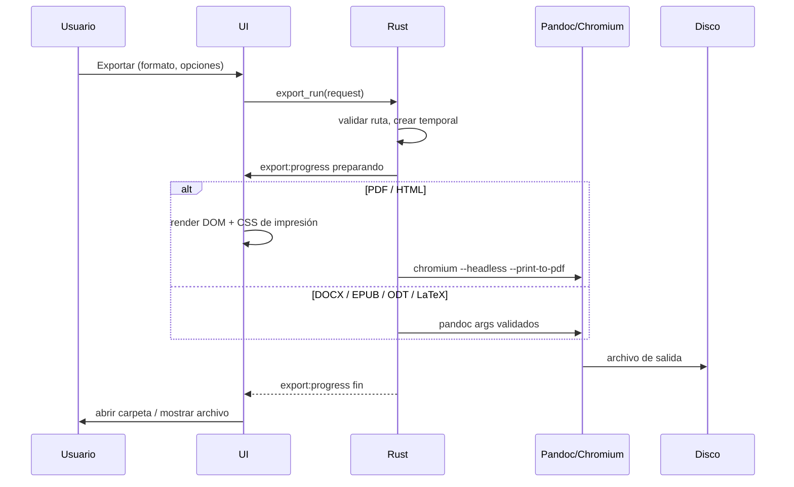

# 12 — Exportación

## 1. Formatos

| Formato | Motor | Fidelidad |
|---|---|---|
| HTML (con estilos) | Render propio + CSS del tema | Alta |
| HTML (sin estilos) | Render propio | Media |
| PDF | Chromium headless (preferido) / Pandoc+XeLaTeX | Alta |
| DOCX | Pandoc (`--reference-doc`) | Alta |
| EPUB | Pandoc | Alta |
| ODT | Pandoc | Media |
| LaTeX | Pandoc (`--standalone`) | Media |
| Markdown limpio | Normalizador | — |
| Imagen (PNG de página) | Chromium | P2 |

## 2. Flujo



## 3. PDF

Opciones:

| Opción | Valores |
|---|---|
| Motor | `chromium` (por defecto), `pandoc` |
| Página | A4, Letter, Legal, personalizado |
| Márgenes | 10–40 mm |
| Encabezado/pie | ninguno, título, número de página |
| TOC | incluir si el documento lo pide |
| Saltos de página | respetar `\newpage`, `---` opcional |
| Imágenes | incrustadas |
| Enlaces | clicables |
| Fuentes | embebidas si el motor lo permite |

Detalles:

- Se usa el mismo CSS y tema que la vista, más `@media print`.
- Se evita cortar tablas, bloques de código y diagramas (`break-inside: avoid`).
- Si no hay Chromium, se ofrece instalar o usar Pandoc/LaTeX.
- Ruta de Chromium configurable; se valida que sea ejecutable.
- Timeout 120 s y cancelación.

## 4. Pandoc

- Detección en `PATH` y ruta manual en preferencias.
- Argumentos construidos con lista blanca, sin shell.
- Formatos: `docx`, `epub3`, `odt`, `latex`, `html5`.
- Metadatos desde frontmatter (`title`, `author`, `date`, `lang`).
- Recursos: imágenes copiadas a un temporal con nombres seguros.
- Errores de Pandoc se muestran con stderr resumido y log completo.
- Versión mínima 3.1; se avisa si es anterior.

## 5. HTML

- Documento autónomo: `<style>` del tema + contenido.
- Opción “incrustar imágenes” (base64).
- Opción “HTML sin CSS” para incrustar en CMS.
- Código resaltado con clases Shiki + CSS.
- KaTeX: CSS/fuentes incrustadas o MathML.
- Mermaid: SVG inline.
- Se sanea el HTML de usuario igual que en el editor.

## 6. Nombres y destino

- Por defecto: mismo directorio, mismo nombre base, extensión destino.
- Si existe: preguntar sobrescribir / renombrar / cancelar.
- Exportación por lotes (P1): varios `.md` a una carpeta.
- Nunca se escribe dentro de la carpeta de instalación.

## 7. Exportación desde CLI

```bash
murk --export pdf notas.md -o salida/notas.pdf --page A4
murk --export docx *.md
```

- Código de salida 0 = éxito; ≠ 0 con mensaje en stderr.
- Sin interfaz si `--headless` (usa el mismo motor).
- Progreso solo en stderr.

## 8. Casos borde

| Caso | Comportamiento |
|---|---|
| Sin Pandoc | Diálogo con enlace de instalación; PDF por Chromium sigue disponible |
| Sin Chromium | Fallback Pandoc+LaTeX; si tampoco hay, error claro |
| Imagen rota | Aviso previo con lista; continuar o cancelar |
| Documento sin guardar | Se exporta el buffer; se avisa de rutas relativas |
| Ruta de salida sin permisos | Error claro, sin tocar el archivo original |
| Nombre con `/` o NUL | Se sanea |
| Fuente no instalada | Sustitución + aviso |
| Exportación cancelada | Se elimina el temporal |

## 9. Criterios de aceptación

1. El PDF conserva el aspecto del editor (tema, fuentes, márgenes).
2. DOCX conserva títulos, listas, tablas, código y matemáticas.
3. EPUB valida con `epubcheck`.
4. Exportar dos veces no duplica recursos ni deja temporales.
5. Cancelar no deja archivos parciales.
6. El HTML exportado se abre sin conexión y sin errores de consola.
