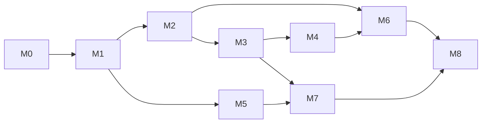

# 22 — Hitos y riesgos

## 1. Hitos

Estimaciones a tiempo parcial (15–20 h/semana). Cada hito termina con demo, pruebas y matriz actualizada.

| Hito | Entregable | Duración |
|---|---|---|
| M0 Fundación | Repo, licencia, CI, scaffold Tauri, ventana | 2–3 días |
| M1 Shell | Pestañas, abrir/guardar, menús, ajustes, sesión | 1–2 sem |
| M2 Núcleo editor | CM6 + GFM, resaltado, undo, búsqueda local | 2–3 sem |
| M3 Preview v1 | Ocultar marcas, headings, énfasis, enlaces, listas, código | 3–4 sem |
| M4 Preview v2 | Imágenes, tablas, math, mermaid, checkboxes | 4–6 sem |
| M5 Archivos | Árbol, watcher, encoding, autosave, recuperación | 2–3 sem |
| M6 Exportación | HTML, PDF, DOCX, EPUB, Pandoc, print CSS | 2–3 sem |
| M7 Paridad | Temas, atajos, spellcheck, IME, outline, focus/typewriter | 3–5 sem |
| M8 Release | deb/rpm/AppImage, updater, docs, QA | 1–2 sem |

**Total:** 5–8 meses. Añadir 30–50 % de colchón.

## 2. Dependencias entre hitos

## 3. Riesgos

| # | Riesgo | Prob. | Impacto | Mitigación |
|---|---|---|---|---|
| R1 | Complejidad del live preview (tablas, IME) | Alta | Alto | Prototipo temprano en M3; presupuesto aparte para tablas |
| R2 | Fidelidad de PDF | Media | Alto | Chromium sidecar; plan B Pandoc+LaTeX; pruebas con documentos reales |
| R3 | WebKitGTK vs Chromium (diferencias CSS/JS) | Media | Medio | Probar en Fedora/Ubuntu; evitar APIs exclusivas |
| R4 | Rendimiento en documentos grandes | Media | Alto | Límites y degradación definidos; benchmarks desde M2 |
| R5 | IME roto por decoraciones | Media | Alto | Reglas duras; pruebas manuales por release |
| R6 | Conflictos de atajos con el sistema | Baja | Medio | Detección y personalización |
| R7 | Pandoc/LaTeX no instalados | Alta | Medio | Detección y mensajes claros; PDF por Chromium |
| R8 | Alcance creep (“como Typora”) | Alta | Alto | Matriz P0/P1/P2; congelar alcance por release |
| R9 | Licencias de dependencias | Baja | Alto | Revisión en `NOTICE.md`; CI de licencias |
| R10 | Pérdida de datos por guardado | Baja | Crítico | Escritura atómica, backups, pruebas de caos |

## 4. Definición de terminado (por función)

1. Especificada en `docs/` y en la matriz.
2. Implementada con pruebas unitarias/E2E.
3. Sin regresiones de rendimiento.
4. Accesible por teclado.
5. Documentada para el usuario.
6. Sin deuda de licencia (assets/deps revisados).

## 5. Estrategia de release

- `0.1` → M2 (editor básico, sin preview).
- `0.2` → M3 (preview v1).
- `0.3` → M4 (tablas/math/mermaid).
- `0.4` → M6 (exportación).
- `0.9` → M7 (paridad funcional, beta).
- `1.0` → M8 (paquetes, updater, QA completo).
