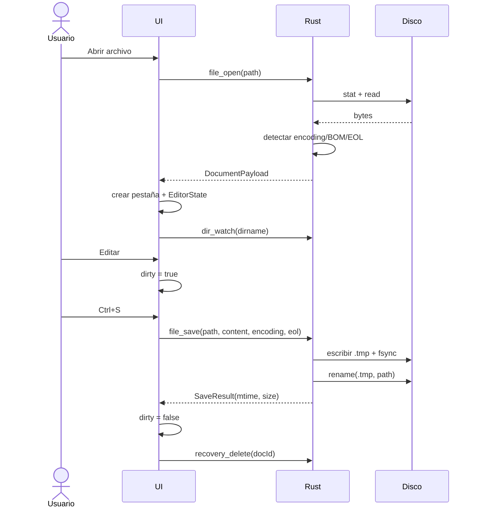
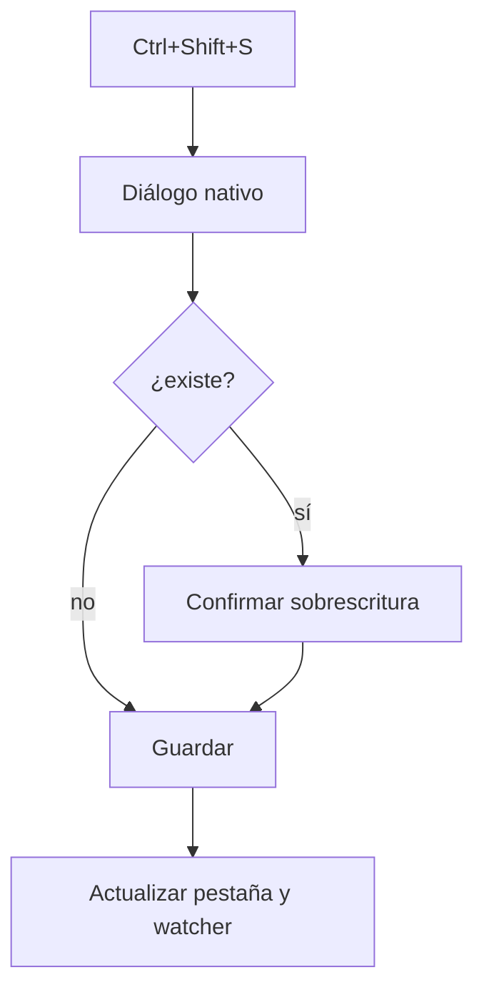

# Flujo — Abrir y guardar

## Reglas
1. Abrir un archivo ya abierto enfoca su pestaña.
2. Guardar sin ruta → diálogo Guardar como.
3. El guardado es atómico; si falla, el original no cambia.
4. No se reescribe si `dirty=false` (mtime intacto).
5. Encoding y EOL se conservan salvo cambio explícito.

## Guardar como

## Conflictos
| Caso | Acción |
|---|---|
| Cambió en disco sin cambios locales | Recarga silenciosa |
| Cambió en disco con cambios locales | Recargar / Mantener / Comparar |
| Archivo borrado | Marcar huérfana; guardar recrea previa confirmación |
| Sin permisos | Mantener buffer; ofrecer Guardar como |
