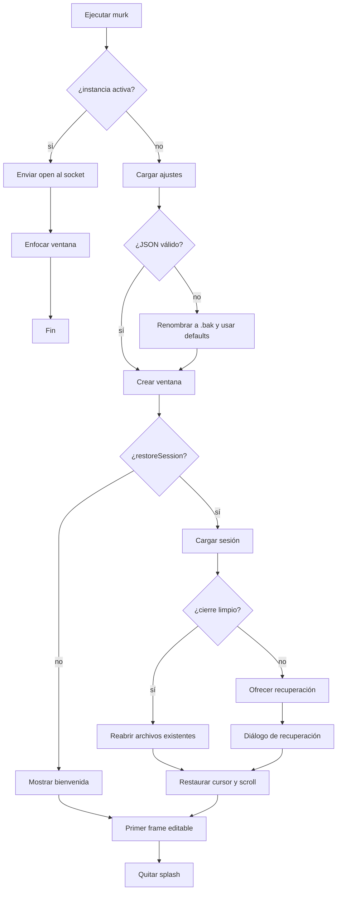

# Flujo — Arranque

## Objetivo
Iniciar Murk en ≤ 1,5 s, restaurar la sesión y estar listo para editar.

## Pasos
1. Parsear CLI (`archivos`, `--new-window`, `--headless`).
2. Comprobar socket de instancia única.
3. Cargar `settings.json`, validar versión y migrar.
4. Crear ventana con tamaño guardado.
5. Cargar `session.json` si está activo.
6. Detectar cierre anómalo (marcador `clean-exit`).
7. Abrir documentos y posiciones.
8. Registrar watchers de los archivos abiertos.

## Ramas de error
| Error | Resultado |
|---|---|
| Ajustes corruptos | Backup `.bak`, defaults, aviso |
| Archivo de sesión inexistente | Bienvenida |
| Archivo de sesión con rutas muertas | Se omiten, aviso discreto |
| Sin permisos de config | Modo efímero con aviso |
| WebKit no disponible | Error fatal con instrucciones |

## Criterios
- Sin red.
- Sin diálogo modal en arranque normal.
- La ventana aparece aunque la sesión tarde; el contenido carga después.
