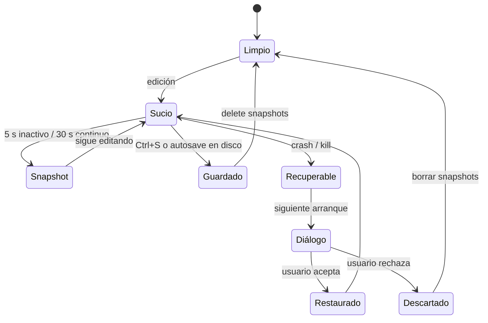

# Flujo — Autoguardado y recuperación

## Snapshot
1. Serializar `{docId, path, content, createdAt, reason}`.
2. Escribir en `~/.config/murk/recovery/<docId>/<ts>.json` de forma atómica.
3. Escribir copia legible `<ts>.md`.
4. Aplicar retención (50 por doc / 7 días).

## Arranque tras crash
1. Leer marcador `clean-exit` (eliminado al arrancar, recreado al salir bien).
2. Si falta, listar snapshots.
3. Mostrar diálogo con archivo, hora y tamaño.
4. Acciones: Restaurar, Ver diff, Descartar.
5. Restaurar abre el contenido en memoria (nunca sobrescribe solo).

## Reglas
- No snapshot durante composición IME.
- No autoguardar en disco si hay conflicto externo.
- Documentos sin ruta solo generan snapshots.
- Guardar correctamente elimina snapshots del documento.

## Criterios
- `kill -9` con cambios → texto recuperable íntegro.
- Cierre normal → 0 snapshots huérfanos.
- Restaurar no marca `dirty` hasta que el usuario edite (pero requiere guardado explícito).
