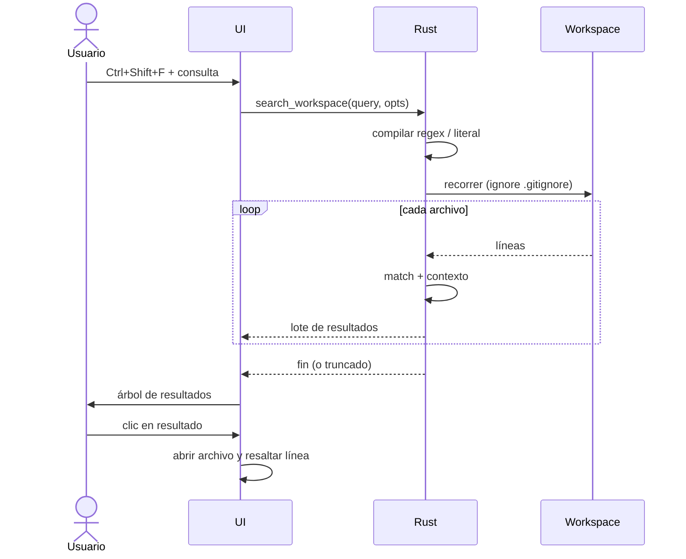

# Flujo — Búsqueda global

## Reglas
- Respeta `.gitignore` y exclusiones (`node_modules`, `target`, `.git`).
- No sigue symlinks por defecto.
- Límites: 10 000 coincidencias, 200 MB, 20 s.
- Cancelable; los resultados parciales se conservan.
- Sin indexación en v1.
- Regex inválida → error inmediato, sin búsqueda.

## Interacción
| Tecla | Acción |
|---|---|
| `Enter` | Abrir resultado activo |
| `F4` | Siguiente resultado |
| `Shift+F4` | Anterior resultado |
| `Esc` | Cerrar panel |
| `Ctrl+Shift+F` de nuevo | Enfocar campo |

## Criterios
- La UI sigue respondiendo durante la búsqueda.
- No se escanean binarios.
- Los conteos coinciden con una búsqueda manual en los fixtures.
