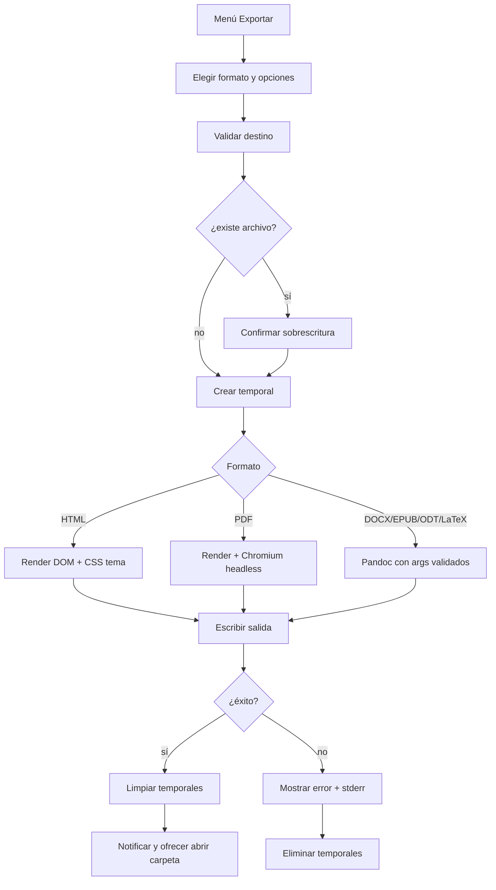

# Flujo — Exportación



## PDF
1. Preparar HTML con tema activo y `@media print`.
2. Incrustar imágenes.
3. Invocar Chromium: `--headless --print-to-pdf --no-pdf-header-footer`.
4. Aplicar página/márgenes.
5. Verificar que el PDF existe y no está vacío.

## Pandoc
```bash
pandoc entrada.md -f gfm -t docx --reference-doc plantilla.docx -o salida.docx
```
- Sin shell; argumentos en array.
- Metadatos desde frontmatter.
- Timeout 120 s; cancelable.

## Errores
| Error | Mensaje |
|---|---|
| Pandoc ausente | “Instala Pandoc o usa PDF por Chromium” |
| Chromium ausente | “Usando Pandoc/LaTeX” o error claro |
| Imagen rota | Aviso previo con lista |
| Sin permisos | Error de ruta con detalle |
| Cancelado | Se borran temporales |

## Criterios
- Sin archivos parciales tras cancelar/fallar.
- El resultado no depende de la red.
- El `.md` original nunca se modifica.
