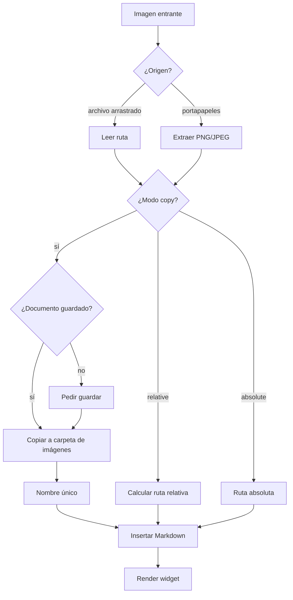

# Flujo — Imágenes (drag & drop y pegado)

## Detalles
- Carpeta por defecto: `assets/` junto al documento.
- Nombre: `image-YYYYMMDD-HHmmss-<hash>.<ext>`.
- Colisión: sufijo `-1`, `-2`.
- Imagen dentro del proyecto: no se copia.
- Deshacer la inserción borra el archivo copiado (si Murk lo creó).
- Fallo de copia: se inserta ruta original y se avisa.

## Formatos
PNG, JPEG, GIF, WebP, AVIF, SVG (saneado), BMP.

## Seguridad
- Protocolo interno con token por documento.
- SVG sin scripts ni referencias externas.
- Sin descarga de imágenes remotas sin autorización.

## Criterios
- Pegar una captura crea archivo y enlace correcto.
- Mover el `.md` con `assets/` conserva las imágenes.
- Imagen borrada → placeholder, sin romper el layout.
