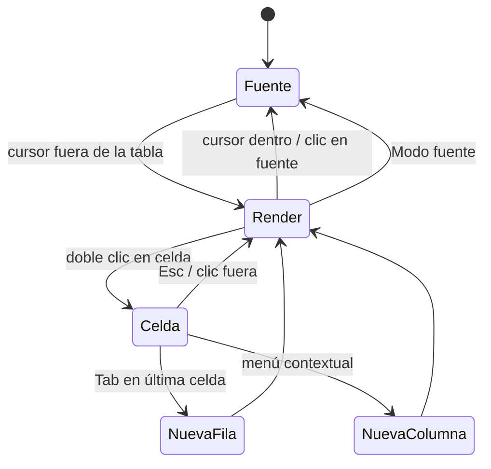

# Flujo — Edición de tablas

## Interacciones
| Acción | Resultado |
|---|---|
| `Tab` | Siguiente celda; crea fila al final |
| `Shift+Tab` | Celda anterior |
| `Enter` | Fila siguiente, misma columna |
| `Esc` | Salir de la tabla |
| `Alt+↑/↓` | Mover fila |
| `Alt+←/→` | Mover columna |
| Clic en borde “+” | Insertar fila/columna |
| Pegar TSV/CSV | Crear tabla nueva |

## Invariantes
- El documento siempre contiene una tabla GFM válida.
- La alineación se conserva.
- Pipes escapados intactos.
- Deshacer revierte la operación completa.

## Degradación
- > 1 000 filas: render por viewport.
- Tabla malformada: se muestra como texto, nunca se “arregla” sola.
