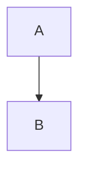

# Plantilla de especificación

Copia este archivo en `docs/` o `specs/` para documentar una función nueva.

````markdown
# <NN> — <Nombre de la función>

## 1. Objetivo
Qué problema resuelve y para quién.

## 2. Alcance
- Incluye:
- No incluye:

## 3. Comportamiento
Descripción observable, paso a paso, sin detalles de implementación.

### Estados
| Estado | Entrada | Salida |
|---|---|---|

### Interacción
| Acción | Resultado |
|---|---|

## 4. Flujo


## 5. Contrato técnico
- Comandos IPC:
- Eventos:
- Estructuras:
- Extensiones CM6:

## 6. Criterios de aceptación
1. …
2. …

## 7. Casos borde
| Caso | Comportamiento |
|---|---|

## 8. Pruebas
- Unitarias:
- E2E:
- Fixtures:

## 9. Dependencias
- Documentos relacionados:
- ADR:

## 10. Estado
- Prioridad: P0 / P1 / P2
- Release:
- Estado: spec / wip / done
- PR:
````

## Reglas de una buena spec

1. Describe **qué** se observa, no solo **cómo** se implementa.
2. Todo criterio debe ser verificable por una prueba.
3. Los casos borde no son opcionales.
4. Si cambia el comportamiento, se actualiza la spec en el mismo PR.
5. Nada de capturas o textos copiados de otro producto.
